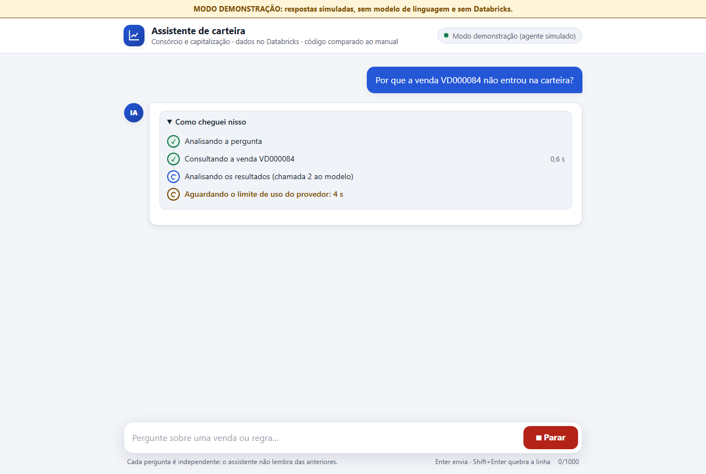
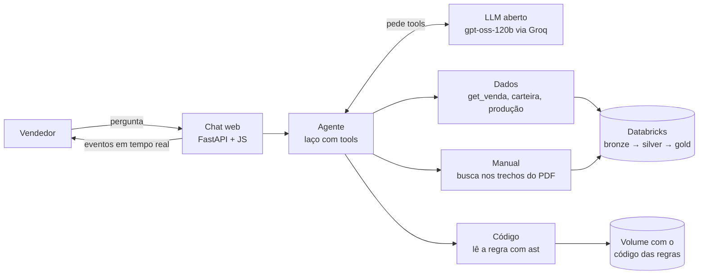
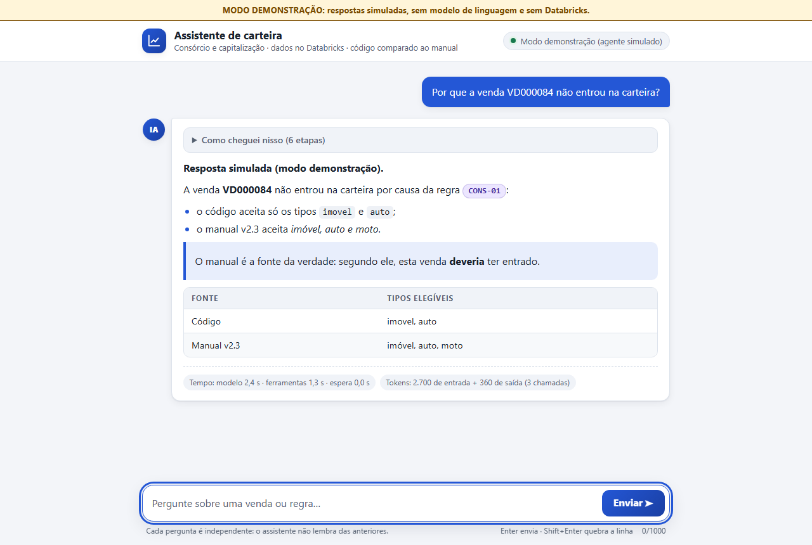

# Agente de IA que explica por que uma venda não entrou na carteira

Um vendedor pergunta: *"Fiz esta venda e ela não apareceu na minha carteira. Por quê?"*. Um agente de IA
investiga como um analista faria: consulta os dados no **Databricks**, lê o **código** da regra de negócio
que excluiu a venda, lê o **manual** da empresa sobre a mesma regra, **compara os dois** e responde citando
a regra. Se o código estiver desatualizado em relação ao manual, ele avisa.

> Projeto de estudo com uma **empresa fictícia** (Alfa Seguridade: consórcio e capitalização) e **dados
> sintéticos**. Nenhum dado real de cliente.



## A ideia central: o código está desatualizado de propósito

O código das regras foi escrito segundo a versão 2.0 do manual. O manual evoluiu até a **v2.3**, e o código
ficou para trás em **4 pontos plantados** (D1 a D4). Por exemplo, o código exclui consórcio de **moto**, mas o
manual atual o aceita. O agente precisa perceber isso sozinho: **o manual é a fonte da verdade**.

| | Regra | Código | Manual v2.3 |
|---|---|---|---|
| D1 | COM-03: prazo de arrependimento | 7 dias | 10 dias |
| D2 | CAP-03: carência da capitalização | 60 dias | 90 dias |
| D3 | CONS-01: tipos de consórcio | sem moto | com moto |
| D4 | COM-01: vendedor ativo | inativo no dia do desligamento | ativo até o dia, inclusive |

O gabarito fica em tabelas `gabarito_*` às quais o agente **não tem acesso**: elas são a "prova".

## Como funciona



1. **Pipeline medalhão no Databricks** (bronze → silver → gold) com 5.000 vendas sintéticas, sujeira
   controlada e cerca de 10% de vendas fora da carteira por casos plantados.
2. **Regras de negócio em Python** (`regras/`), com uma interface única por produto e testes.
3. **7 tools somente leitura**: consultam a venda, a carteira, a produção, as regras aplicadas, o código de
   uma regra e o manual. O SQL é sempre **parametrizado**, e o código das regras é lido com `ast`, **nunca
   executado** pelo agente.
4. **Agente com laço próprio** (sem framework): o modelo **pede** tools e o nosso código as executa,
   com validação de argumentos, limite de passos, contagem de tokens e espera automática quando o provedor
   devolve HTTP 429.
5. **Chat web local** que mostra cada etapa enquanto ela acontece, inclusive a contagem regressiva quando o
   provedor pede para esperar.



## Destaques técnicos

- **Streaming de eventos:** o agente é síncrono; ele roda numa thread e emite eventos que chegam ao
  navegador como NDJSON. Todo fluxo termina com **exatamente um** evento final (`fim`, `erro` ou `cancelado`).
- **Segurança levada a sério**, mesmo num projeto local:
  - o texto do modelo é tratado como **não confiável**: a resposta é montada só com `createElement` e
    `textContent`, sem nenhum `innerHTML` (um teste varre o JavaScript);
  - **CSP estrita**, servidor só em `127.0.0.1`, cabeçalhos `Host` e `Origin` conferidos (contra
    *DNS rebinding* e contra outras páginas usando o chat);
  - mensagens de erro e logs passam por um filtro que remove chaves, tokens e caminhos do servidor.
- **Uma pergunta por vez**, timeout e botão **Parar**, que interrompe na hora a espera por limite de uso.
- **354 testes automatizados** (pytest), validados com **testes de mutação**: quebrar o código de propósito
  e confirmar que algum teste falha.
- **Infraestrutura como código:** Terraform para o catálogo, os schemas e os volumes do Unity Catalog.
- **Modo demonstração:** o agente real com um modelo e tools falsos. Dá para ver tudo funcionando **sem
  chaves, sem custo e sem Databricks**.

Medido com o modelo real, num caso de controle: cerca de **6.300 tokens e 38 s por pergunta** (4 chamadas ao
modelo e 3 consultas ao warehouse).

## Experimente em 1 minuto (sem chaves)

```bash
pip install -r requirements.txt
python scripts/servir_chat.py --agente-falso
```

Abra **http://127.0.0.1:8000** e clique num dos cenários da demonstração: resposta normal, espera por limite
de uso, erros, Parar e até uma resposta com conteúdo malicioso, que deve aparecer só como texto.

## Rodando de verdade

Precisa de um workspace Databricks (a Free Edition serve) e de uma chave de um provedor de LLM compatível com a
API da OpenAI (o projeto usa o Groq).

1. Copie `.env.example` para `.env` e preencha (`python scripts/verificar_env.py` confere o arquivo **sem
   mostrar os valores**).
2. Crie a estrutura com Terraform (veja [Infraestrutura](#infraestrutura)) e rode os notebooks `01` a `05`
   no Databricks.
3. Teste as tools e o modelo: `python scripts/tools_ao_vivo.py` e `python scripts/testar_llm.py`.
4. Pergunte:
   - na linha de comando: `python scripts/perguntar.py "Por que a venda VD000084 não entrou na carteira?"`;
   - ou no chat: `python scripts/servir_chat.py`.

Com Docker: `docker compose run --rm dev` abre um shell com Python, Terraform e a CLI do Databricks, e
`docker compose up chat` sobe o chat (a porta é publicada só em `127.0.0.1`).

## Estrutura

| Pasta | Conteúdo |
|---|---|
| `agentes/` | o laço do agente, os provedores de LLM e as 7 tools |
| `chat/` | servidor FastAPI e front-end estático (sem framework); veja [`chat/README.md`](chat/README.md) |
| `regras/` | regras de negócio por produto ([`README_regras.md`](README_regras.md)) |
| `notebooks/` | pipeline bronze → silver → gold, gabarito e chunks do manual |
| `ingestao/` | divide o manual em PDF em trechos (um por regra) |
| `terraform/` | catálogo, schemas e volumes do Unity Catalog |
| `scripts/` | diagnóstico, geração de casos, linha de comando e servidor do chat |
| `tests/` | 354 testes (pytest), sem Databricks nem LLM |
| `docs/` | manual v2.3 em PDF e o [contexto completo do projeto](docs/CONTEXTO_DO_PROJETO.md) |

## Testes

```bash
pytest                                   # 354 testes; nenhum fala com o Databricks ou com o LLM
python scripts/verificar_repositorio.py  # confere se a cópia local tem todos os arquivos, nas versões certas
```

## Próximos passos

- **Avaliação automática** do agente nos casos plantados: ele detecta as divergências D1 a D4? Inventa dados?
- Reduzir o custo em tokens por pergunta.
- Dividir em agentes especialistas (dados, regras, manual) com um orquestrador e rastreio.
- Um **agente auditor** que corrige as divergências no código e mede o efeito na carteira.

## Infraestrutura

```bash
cp .env.example .env        # preencha host e token
docker compose run --rm dev # shell com Terraform, Databricks CLI e Python
cd terraform && terraform init && terraform plan -out=tfplan   # leia o plano antes de aplicar
terraform apply tfplan
```

Se o catálogo já existe (você rodou o notebook 01 antes), importe antes do `apply`:

```bash
terraform import databricks_catalog.vendas_ia vendas_ia
terraform import 'databricks_schema.camadas["bronze"]' vendas_ia.bronze
terraform import 'databricks_schema.camadas["silver"]' vendas_ia.silver
terraform import 'databricks_schema.camadas["gold"]' vendas_ia.gold
terraform import 'databricks_schema.camadas["apoio"]' vendas_ia.apoio
terraform import databricks_volume.raw vendas_ia.bronze.raw
terraform import databricks_volume.docs vendas_ia.apoio.docs
```

O state do Terraform fica local e não vai para o Git. Nunca versione o `.env` nem os `*.tfvars`.
